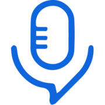

# Podstatus for Claude

**Podcast stats for podcasters.**

Podcast analytics for podcasters: track Apple Podcasts, Spotify and iVoox rankings, read listener reviews and draft client updates with Podstatus.

## Connect in Claude

In **Customize → Connectors**, add a custom connector with URL
`https://podstatus.com/mcp`. Choose **Sign in now** and **Register automatically**
for the OAuth client. Podstatus uses dynamic client registration (DCR); published
client identity (CIMD) is not supported in this version. Leave credential headers
empty, sign in on Podstatus and approve the read permissions. Organization policy
may require an administrator to add the connector.

The hosted connector loads the MCP tools. To load the packaged skill in Claude
Code, run these commands from this repository's root:

```sh
claude plugin validate --strict .
claude --plugin-dir .
```

Use `/mcp` to connect and sign in, then ask for a podcast review. Use a current
Claude Code release: directory metadata fields require version 2.1.281 or later
for strict validation. No API key or local MCP server is needed. Claude's hosted
connector requires the endpoint to be reachable from Anthropic's cloud.

A public plugin directory listing is a separate publication step. This repository
can be validated locally and does not claim directory approval.

## What you can do

- Check Apple Podcasts, Spotify and iVoox rankings, discover observed markets in one call and compare chart history.
- Summarize listener reviews, with real quotations and source dates.
- Explore positions for keywords already tracked in Podstatus.
- Compare up to five tracked podcasts in one market.
- Use OP3 downloads and audience analytics when the source is connected and data exists.
- Draft a client update or list available Podstatus reports.

You need a **Professional or Network subscription with API access enabled** in
Podstatus. Contact [hello@podstatus.com](mailto:hello@podstatus.com) if access is
not enabled. The plugin accesses your tracked podcasts and approved permissions;
it is not an unrestricted podcast search or data feed.

## Try these prompts

- “List my tracked podcasts.”
- “Compare my podcast's rankings this week with last week. Include the market and dates.”
- “Summarize this month's reviews and quote two examples.”
- “Draft a weekly client update using rankings and listener feedback.”

The included `podcast-review` skill guides the assistant to resolve your podcast,
retrieve relevant data and separate measured results from interpretation. It can
respond in your language. If you track multiple podcasts, specify which one.

## Permissions and limitations

OAuth access is **read-only by default**. The six read scopes cover podcasts,
rankings, analytics, reviews, keywords and report listings. With all six granted,
the connection exposes sixteen tools. Data calls share your account's daily quota with
other keys and connections; installing another client does not increase it. Protocol
setup and pings still use minute capacity, but do not spend the daily data quota.

No YouTube metrics or visual dashboard are included. Coverage depends on your
tracked sources and available history. Missing data is unknown, not zero; OP3
downloads are not a count of unique people. Data may be cached, so retain the
returned measurement dates and stale flags when reporting it.

Drafting text does not create a paid PDF. Generating a Podstatus report requires a
separate `reports:write` grant, explicit confirmation and a report credit. The
default connection does not grant that permission; asking in chat cannot add it.

Manage or revoke your connection at
[Podstatus API settings](https://podstatus.com/settings/api). For access errors,
check activation and reconnect through the client's settings. For rate limits,
wait for the retry interval instead of repeatedly retrying or switching keys.

## Support and documentation

- [MCP documentation](https://podstatus.com/docs/mcp)
- [API documentation and support contact](https://podstatus.com/docs/api)
- [Privacy policy](https://podstatus.com/privacy)
- [Terms of use](https://podstatus.com/legal)
- [Security and data handling](SECURITY.md)
- Support: [hello@podstatus.com](mailto:hello@podstatus.com)

## Package and license

This repository contains only the plugin configuration, skill, documentation and
brand icon. It does not contain the Podstatus server, customer records, credentials
or a local service to run. The hosted endpoint must be deployed and enabled before
sign-in can work. A public repository does not imply directory approval or listing.

Package files are [MIT licensed](LICENSE), with the brand and hosted service
excluded as explained in [NOTICE.md](NOTICE.md). See [CHANGELOG.md](CHANGELOG.md)
and the reusable listing text in [DIRECTORY.md](DIRECTORY.md).

To enable paid report generation in a separately configured client, request the existing read scopes plus `reports:write`, reconnect through OAuth, approve the credit warning, and refresh `tools/list`. Keep `reports:read` to check progress. The published package remains read-only. If your client cannot change scopes, create the report in Podstatus. Permission consent does not replace confirmation of each report.
